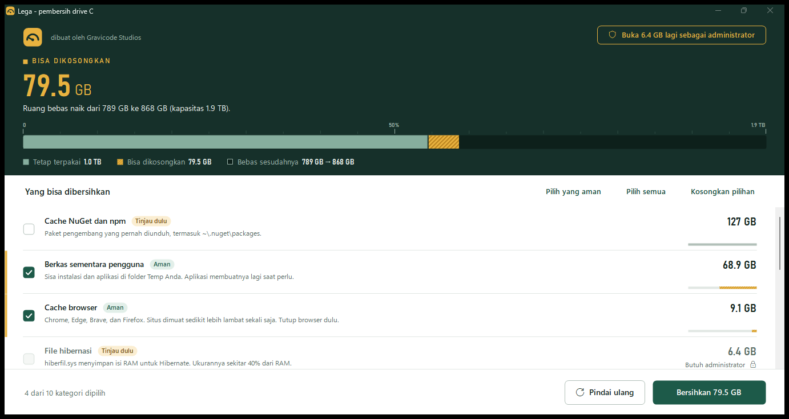

# Lega - pembersih drive C untuk Windows 11

WinForms, .NET 10. Memindai lalu membersihkan berkas yang aman dihapus supaya ruang bebas di drive C naik.

Dibuat oleh **Gravicode Studios**, dipimpin oleh **Kang Fadhil**.



## Unduh

Ambil `Lega-Setup-x.y.z.exe` dari halaman [Releases](https://github.com/DotNetVibeCoderz/Vibe_Utilities/releases?q=lega)
(tag `lega-v*`). Installer berisi exe self-contained, jadi tidak perlu memasang .NET terpisah.
Secara bawaan dipasang per pengguna tanpa UAC. Pilih "untuk semua pengguna" di dialog awal bila ingin ke Program Files.

## Tampilan

- **Panel instrumen** di atas: angka besar adalah ruang yang akan kembali, lalu meter drive C dengan skala.
  Hijau sage = tetap terpakai, kunyit berarsir = bisa dikosongkan, gelap = bebas.
- Warna kunyit hanya punya satu arti, yaitu ruang yang bisa dikosongkan. Ia muncul di angka besar,
  di meter, di tepi baris yang dicentang, dan di tombol administrator (yang membuka GB tambahan).
- Selama membersihkan, meter bergerak sungguhan: arsiran menyusut dan ruang bebas melebar per kategori.
  Setelah selesai, angka "kembali ke drive C" dihitung naik dari nol.
- Keyboard: Tab ke daftar, panah atas/bawah dan Home/End untuk berpindah baris, Spasi untuk mencentang.
- Animasi mati otomatis bila efek animasi Windows dimatikan.
- Klik logo untuk info versi dan pembuat.

## Menjalankan dari kode

```powershell
cd Lega
dotnet run
```

Build installer (butuh [Inno Setup 6](https://jrsoftware.org/isinfo.php), `winget install JRSoftware.InnoSetup`):

```powershell
powershell -File installer\build.ps1 -Version 1.0.0
```

Hasilnya `installer\Output\Lega-Setup-1.0.0.exe`. Skrip ini menjalankan `dotnet publish` (self-contained, satu file)
lalu `ISCC`. Ikon dibuat ulang dengan `installer\make-icon.ps1`.

## Yang dibersihkan

| Kategori | Perkiraan | Risiko | Admin |
|---|---|---|---|
| Instalasi Windows sebelumnya (Windows.old) | 10-30 GB | Hati-hati | ya |
| File hibernasi (hiberfil.sys) | 40% RAM | Tinjau dulu | ya |
| Cache Windows Update | 1-10 GB | Aman | ya |
| Sisa komponen Windows (WinSxS, via DISM) | 1-5 GB | Aman | ya |
| Recycle Bin | bervariasi | Tinjau dulu | tidak |
| Cache browser (Chrome, Edge, Brave, Firefox) | 0.5-5 GB | Aman | tidak |
| Berkas sementara pengguna dan Windows | 0.2-10 GB | Aman | sebagian |
| Cache Delivery Optimization | 0.1-5 GB | Aman | ya |
| Laporan error dan crash dump | 0.1-5 GB | Aman | sebagian |
| Cache thumbnail dan ikon | kecil | Aman | tidak |
| Cache NuGet dan npm | 1-10 GB | Tinjau dulu | tidak |

Kategori yang tidak ada di PC (misalnya tidak ada Windows.old) otomatis disembunyikan.

## Cara kerja

- Saat dibuka, Lega memindai semua kategori secara paralel (maksimal 3 sekaligus). Belum ada yang dihapus.
- Hanya item berisiko "Aman" yang dicentang otomatis. Item "Tinjau dulu" dan "Hati-hati" harus Anda centang sendiri,
  dan dialog konfirmasi menjelaskan dampaknya.
- Item yang butuh administrator tetap tampil dengan ukurannya. Tombol di kanan atas menjalankan ulang aplikasi
  dengan UAC dan menunjukkan berapa GB tambahan yang terbuka.
- Setelah selesai, tiap kategori dipindai ulang dan angka "kembali ke drive C" diambil dari selisih ruang bebas
  yang sebenarnya, bukan dari perkiraan.

## Pengaman

- Tidak pernah menyentuh root drive, dan tidak mengikuti symlink atau junction.
- Berkas yang sedang dipakai dilewati, bukan dipaksa.
- Cache browser hanya folder cache. Password, cookie, dan riwayat tidak disentuh.
- Layanan Windows Update dihentikan sementara saat membersihkan cache-nya, lalu dinyalakan lagi.

## Struktur

```
Core/Sys.cs        admin, proses, P/Invoke Recycle Bin, util berkas, format ukuran
Core/Cleaners.cs   kategori dan katalognya (tambah kategori baru di Catalog.Build)
UI/Theme.cs        palet (pinus, sage, kunyit) dan font (Bahnschrift untuk angka, Segoe UI Variable untuk teks)
UI/HeroPanel.cs    panel instrumen: label, angka besar, meter berskala, keterangan
UI/Logo.cs         logo meter tekanan (header dan ikon jendela)
UI/CategoryRow.cs  baris kategori (custom paint, keyboard, dan akses Narrator)
UI/ActionButton.cs tombol (dengan ikon opsional) dan garis aktivitas
UI/MainForm.cs     layout, alur pindai dan bersihkan
installer/         skrip ikon, skrip build, dan Lega.iss (Inno Setup)
```
